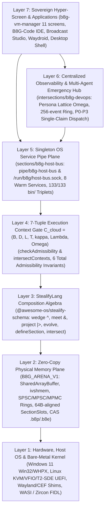
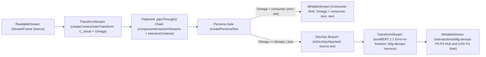

# Awesome-OS / StealifyLang / B8G Microkernel — Canonical Architecture

> **Status:** Authoritative Root Blueprint (Verified against live workspace sources)
> **Scope:** First-principles system architecture spanning the canonical **Sectium · B8G · StealifyLang** stack, `B8G_ARENA_V1`, `@awesome-os/stealify-schema`, the 7-tuple Execution Context Algebra $\mathcal{C}_{\text{cloud}}$, the Singleton OS Host-Service Pipe Bus (`sections/b8g-host-bus`), Centralized DevOps & Emergency Routing (`intersections/b8g-devops`), Sovereign Hyper-Screen & Runtime Subsystems, and Universal Bin-Shim Virtualization.

---

## Canonical 3-Pillar Stack (`Sectium` · `B8G` · `StealifyLang`)

| Pillar / Identity | Role in Awesome-OS | Concrete Scope & Guarantees |
| :--- | :--- | :--- |
| **`Sectium`** | **Core Engine & Main Dependency** *(Fundament)* | Open-source BSD-3 Chromium-derived core engine & fundamental runtime substrate (`0` closed Google/Microsoft DLLs — zero `WidevineCdm`, `optimization_guide_internal`, `oneds`/`telclient`, or `GoogleUpdate`). |
| **`B8G`** | **Additions, OS/ABI Runtime & Toolchains** | All Awesome-OS additions running on `Sectium`: zero-copy `B8G_ARENA_V1` shared memory, `B8G-ABI`, singleton `b8g-host-bus`, strangler-fig shims (`b8g-electron`, `b8g-cef-shim`, `b8g-wl-shim`), and `.b8p` CAS toolchains. |
| **`StealifyLang` + `Holo` (`holo-compiler`)** | **Algebraic Universal Language Helper & Holonomic Compiler Frontend** | Erasable TypeScript superset, **`Holo` (`holo-compiler`)** path-independent zero-AST compiler frontend, schema/composition algebra (`wedge ^`, `meet &`, `project \|>`, `evolve`), 7-tuple Execution Context $\mathcal{C}_{\text{cloud}}$, and static lint/verification (`stealifylang`, `stealify-lint`). |
| **`Lumi`** | **Mascot** | Canonical Awesome-OS / `Sectium` / `B8G` companion mascot across documentation, desktop surfaces, and developer tooling. |

---

## 1. System Vision & Core Thesis

Awesome-OS replaces fragmented desktop/cloud stacks (duplicated Electron/Chromium runtimes, ad-hoc localhost HTTP daemons, ambient host binaries, and unverified runtime glue) with a **single self-hosted, capability-gated, zero-copy operating system platform** built on five non-negotiable architectural axioms:

1. **Zero-Copy Physical Memory (`B8G_ARENA_V1`):** All hot-path state, telemetry rings, and cross-unit data planes live in cache-aligned `SharedArrayBuffer` / `ivshmem` arenas (`B8G_ARENA_V1`) described by flat binary struct layouts rather than JSON serialization loops.
2. **Zero Local HTTP IPC (`B8G016`):** Same-boundary local OS, VM, and daemon communication is forbidden from binding `localhost` HTTP/TCP ports (eliminating `EADDRINUSE` races and ambient loopback exposure). Local IPC routes exclusively through `arena-sab`, the singleton OS Named Pipe / Unix Domain Socket (`\\.\pipe\b8g-host-bus` / `/run/b8g/host-bus.sock`), or Chromium DevTools Protocol pipes (`--remote-debugging-pipe` + `Runtime.addBinding`).
3. **Zero Ambient Host Binaries (`bin/`):** Developer tools, runtimes, compilers, and platform CLIs never invoke un-shimmed ambient host binaries directly. Every entrypoint resolves through `@awesome-os/bin-shim`, `stealifylang`, or an atomic `(posix, .cmd, .ps1)` triplet in `bin/`.
4. **Algebraic Composition (`@awesome-os/stealify-schema`):** Sections (single-domain state/substrate units) and Intersections (multi-section rendezvous) compose algebraically via `wedge`, `meet`, `project`, `evolve`, `defineSection`, `intersect`, and `intersectContexts` under a formal 7-tuple execution context gate $\mathcal{C}_{\text{cloud}}$.
5. **Zero-Cost Consumer Persona Isolation ($\Omega$):** Observability, diagnostics, and multi-agent emergency response are centralized in `intersections/b8g-devops` and strictly gated by the Persona Lattice $\Omega$. Under the default `consumer` persona, diagnostic emitters short-circuit before allocation so $M_{\text{runtime}}(\text{consumer}) = M_{\text{app}}$.

---

## 2. Master Layered Architecture Diagram

---

## 3. StealifyLang Composition Algebra & 7-Tuple Execution Context

**Canonical Sources:**
- [`packages/@awesome-os/stealify-schema/src/algebra.mts`](packages/@awesome-os/stealify-schema/src/algebra.mts)
- [`packages/@awesome-os/stealify-schema/src/schema-definition.mts`](packages/@awesome-os/stealify-schema/src/schema-definition.mts)
- [`packages/@awesome-os/stealify-schema/src/intersection-stream.mts`](packages/@awesome-os/stealify-schema/src/intersection-stream.mts)
- [`packages/@awesome-os/stealifylang-cli/context-algebra.mts`](packages/@awesome-os/stealifylang-cli/context-algebra.mts)
- [`STEALIFYLANG-SPEC.md`](STEALIFYLANG-SPEC.md) (§10)

### 3.1 The 4 Algebraic Operators & Schema Primitives

Awesome-OS models memory slices, capabilities, host boundaries, and copy-on-write state transitions through four first-principles operators plus declarative schema constructors:

| Primitive / Operator | Symbol | Signature / Location | Formal Semantics |
| :--- | :---: | :--- | :--- |
| **Exterior Product (`wedge`)** | `^` | `wedge(id, A, B)` (`algebra.mts#L56-L76`) | Composes two Sections iff their field subspaces are strictly orthogonal ($\text{keyof } A \cap \text{keyof } B = \emptyset$). Field collisions fail at compile time (`AssertOrthogonalFields`) and runtime (`WedgeCollapseError`). |
| **Capability Meet (`meet`)** | `&` | `meet(c1, c2)` (`algebra.mts#L104-L111`) | Meet-semilattice greatest lower bound: intersects scopes (`c1.scopes ∩ c2.scopes`) and takes $\max(\text{epoch})$. Authority is strictly monotonic and can only shrink. |
| **Manifold Projection (`project`)** | `\|>` | `project(M, chart)` (`algebra.mts#L169-L180`) | Projects an internal manifold value onto either an `internalChart` (full speed, `debugProfile: 'off'`) or a `hostChart` (`legacy-host`, explicitly stamped with `debugProfile` and `autoExitMs` for `wgpu`, `vt100`, `http`, `uefi`, or `sab`). |
| **Epoch Delta (`evolve` / `rollback`)** | $\nabla$ | `evolve(S, delta)` / `rollback(S)` (`algebra.mts#L200-L214`) | Advances an immutable `EpochSnapshot<T>` monotonically (`epoch + 1`) with a parent pointer for $O(1)$ snapshot rollback. |
| **Section & Slot Constructors** | — | `defineSection`, `defineSectionSlot`, `slot`, `f.*`, `s.*` (`schema-definition.mts`) | Declares a self-hydrating Section with typed binary fields (`f.*`), physical substrate (`s.sabRing`, `s.sqlite`, `s.disk`, `s.uvsCas`, `s.ptyStream`, `s.httpOrigin`, `s.computed`), and an embedded `context?: ExecutionContext`. |
| **Rendezvous & Context Composition** | — | `intersect`, `defineIntersection`, `intersectContexts` (`schema-definition.mts`, `algebra.mts#L625-L706`) | Flattens Sections/Slots onto a deduplicated 64B-aligned `SharedArrayBuffer` layout and algebraically composes their `ExecutionContext` contracts (throwing `ContextConflictError` on incompatible concrete boundaries or sovereignty violations). |
| **Zero-AST Surface DSL (`alg`)** | — | `alg` tagged template / `compileAlgebra` (`algebra.mts#L253-L394`) | Compiles inline `blade`, `manifold`, and `chart` declarations directly into live `SectionDefinition` and `IntersectionDefinition` objects with zero AST overhead. |

### 3.2 The 7-Tuple Execution Context ($\mathcal{C}_{\text{cloud}}$)

Every StealifyLang section, intersection, service, container, or desktop surface executes inside a formal 7-tuple over finite lattices:

$$\mathcal{C}_{\text{cloud}} = (B,\; D,\; L,\; T,\; \kappa,\; \Lambda,\; \Omega)$$

| Axis | Name | Domain / Total Order | Composition Rule in `intersectContexts` |
| :---: | :--- | :--- | :--- |
| $B$ | **Boundary** | `bare-metal \| host-win32 \| host-posix \| in-process \| microvm \| wasi` | Unique concrete boundary if non-`in-process` values agree; distinct concrete boundaries throw `ContextConflictError`. |
| $D$ | **Display** | `headless (0) < background-job (1) < interactive-fg (2)` | Lattice join: $\max(\text{displayRank})$. |
| $L$ | **Lifetime** | `oneshot (0) < window-bound (1) < singleton-service (2)` | Strictest persistence: $\max(\text{LIFETIME\_RANK})$. |
| $T$ | **IPC Transport** | `arena-sab (0) < os-pipe (1) < cdp-pipe (2) < external-http (3)` | Most local non-HTTP preferred: $\min(\text{TRANSPORT\_LOCALITY\_RANK})$. |
| $\kappa$ | **Capability** | `(tenantId, scopes, epoch, privateData?)` | Sorted deduplicated union of `scopes`, $\max(\text{epoch})$, logical OR of `privateData`. |
| $\Lambda$ | **Locality** | `local-arena (0) < lan-peer (1) < sovereign-edge (2) < cloud-region (3)` | Strictest sovereignty: $\min(\text{localityRank})$. |
| $\Omega$ | **Persona** | `consumer (0) < creator (1) < devops (2) < kernel-audit (3)` | Lattice join: $\max(\text{personaRank})$; defaults to `consumer` when omitted. |

### 3.3 The 6 Total Admissibility Invariants

`checkAdmissibility(req, caller, opts)` evaluates six total admissibility invariants before an operation or service binding is permitted:

| # | Invariant | Formal Condition | Runtime Violation Code(s) | Code Pointer |
| :-: | :--- | :--- | :--- | :--- |
| 1 | **Visual Reachability** | $D_{\text{req}} \preceq D_{\text{caller}}$ | `VISUAL_REACHABILITY` | [`algebra.mts#L534-L540`](packages/@awesome-os/stealify-schema/src/algebra.mts#L534-L540) |
| 2 | **Local IPC Purity (`B8G016`)** | $(B_{\text{req}} = B_{\text{caller}}) \land (\neg\text{isExternalWeb}) \implies T_{\text{req}} \neq \text{external-http}$ | `LOCAL_IPC_PURITY` (static gate: `B8G016`) | [`algebra.mts#L542-L549`](packages/@awesome-os/stealify-schema/src/algebra.mts#L542-L549), [`audit-rules.mts#L1702-L1721`](packages/@awesome-os/stealifylang-cli/audit-rules.mts#L1702-L1721) |
| 3 | **Capability Inclusion & Epoch Fence** | $(\text{scopes}_{\text{req}} \subseteq \text{scopes}_{\text{caller}} \lor \text{*} \in \text{scopes}_{\text{caller}}) \land (\text{epoch}_{\text{req}} = \text{epoch}_{\text{caller}})$ | `CAPABILITY_INCLUSION`, `CAPABILITY_EPOCH` | [`algebra.mts#L551-L568`](packages/@awesome-os/stealify-schema/src/algebra.mts#L551-L568) |
| 4 | **CISO Data-Locality Sovereignty** | $(\text{privateData}_{\text{req}} \lor \text{privateData}_{\text{caller}}) \implies \Lambda_{\text{req}} \preceq \text{lan-peer}$ | `DATA_SOVEREIGNTY` | [`algebra.mts#L570-L577`](packages/@awesome-os/stealify-schema/src/algebra.mts#L570-L577) |
| 5 | **Singleton Pipe Ownership** | $\|\text{Owners}(p)\| \le 1$ (`0` $\to$ `bind`, `1` $\to$ `attach`, $\ge 2$ $\to$ reject) | `SINGLETON_PIPE_OWNERSHIP` | [`algebra.mts#L579-L591`](packages/@awesome-os/stealify-schema/src/algebra.mts#L579-L591), [`sections/b8g-host-bus/index.mts#L187-L205`](sections/b8g-host-bus/index.mts#L187-L205) |
| 6 | **Persona / Observability Isolation ($\Omega$)** | $\Omega_{\text{req}} \preceq \Omega_{\text{caller}}$ and $\text{Emit}(e, \Omega_{\text{caller}}) \iff \Omega_e \preceq \Omega_{\text{caller}}$ | `PERSONA_ISOLATION` | [`algebra.mts#L593-L601`](packages/@awesome-os/stealify-schema/src/algebra.mts#L593-L601), [`intersections/b8g-devops/index.mts#L204-L212`](intersections/b8g-devops/index.mts#L204-L212) |

### 3.4 Composed Web Streams Intersection Topology (`.pipeThrough()` + `.tee()`)

Runtime intersections project the 7-tuple $\mathcal{C}_{\text{cloud}}$ algebra onto pure, zero-`node:*` standard Web Streams (`ReadableStream` -> `TransformStream` -> `.tee()` -> `WritableStream`) in [`packages/@awesome-os/stealify-schema/src/intersection-stream.mts`](packages/@awesome-os/stealify-schema/src/intersection-stream.mts):

- **Flattened Algebraic Pipeline (`composeIntersectionStreams`):** Chains stage streams via `stages[0].readable.pipeThrough(stages[1]).pipeThrough(...)` into a single `ComposedIntersectionStream` while computing the unified 7-tuple context via `intersectContexts(id, stages.map(s => s.context))`.
- **Structural Zero-Cost Consumer Isolation (`createPersonaTee`):** When `!isDevOpsAttached(callerCtx)` ($\Omega = \text{consumer}$), `createPersonaTee` performs **zero `.tee()` calls** and returns `{ consumer, devops: null }`, keeping consumer pipelines free of tee buffering. When $\Omega \succeq \text{devops}$, it calls `source.tee()` to fan out consumer and DevOps branches without mutating the consumer path.
- **`lumiBERT` 1:1 Error-to-Solution Transform:** On the DevOps `.tee()` branch, `error` frames stream into [`sections/lumi-bert/index.mts`](sections/lumi-bert/index.mts) (`LumiBertEncoder`) and [`intersections/b8g-devops-harness/index.mts`](intersections/b8g-devops-harness/index.mts) (`DevOpsErrorHarness.resolveError1To1`), emitting verified 1:1 `fix` frames from `ErrorFixCasSection` and escalating unverified faults to `intersections/b8g-devops` (`P2` / `dev-error-loop`).

---

## 4. Centralized Observability & Multi-Agent Emergency Routing (`intersections/b8g-devops`)

**Canonical Source:** [`intersections/b8g-devops/index.mts`](intersections/b8g-devops/index.mts)

All platform telemetry aggregation, advisory diagnostics, health probes, and incident dispatch are consolidated into one declarative intersection (`B8gDevOpsIntersection = intersect('b8g/devops', [B8gDevOpsTelemetrySection, B8gDevOpsAdvisorySection])`, gated by `B8G_DEVOPS_CONTEXT` with `persona: 'devops'`, `transport: 'os-pipe'`, `scopes: ['devops.observe']`, `privateData: true`, `locality: 'local-arena'`).

### 4.1 Persona Lattice & Zero-Cost Consumer Projection

The Persona Lattice is totally ordered:

$$\Omega = \{\text{consumer} \prec \text{creator} \prec \text{devops} \prec \text{kernel-audit}\}$$

- **Default:** Unspecified callers default to `consumer` (`personaRank = 0`). Elevation occurs explicitly via `B8G_PERSONA`, `B8G_DEVOPS=1`, or `CI=1`.
- **Zero-Cost Consumer Projection:**

$$M_{\text{runtime}}(\text{consumer}) = M_{\text{app}}$$

In `emitDevOpsEvent(input, callerCtx)`, the very first check evaluates `shouldEmitForPersona(input.minPersona, callerPersona)`. When `false`, the call increments `totalDroppedForConsumerCount` and returns `false` immediately with **zero** event object allocation, **zero** ring-buffer writes (256-event bounded ring), **zero** `console.warn` output (which also requires `isDevOpsAttached(callerCtx)`), and **zero** emergency-worker dispatch.

### 4.2 P0–P3 Single-Claim Emergency Worker Dispatch

`registerEmergencyWorker(kind, handler)` enforces **single-claim ownership** per `EmergencyWorkerKind` (a new claimant replaces any prior handler and returns an idempotent disposer), preventing multi-agent swarms from duplicating remediation on the same incident plane. `resolveEmergencyWorker(severity, domain)` deterministically routes every admitted event:

| Severity | Primary `DevOpsDomain` | `EmergencyWorkerKind` | Operational Mandate |
| :---: | :--- | :--- | :--- |
| **P0** | `security` | `security-containment` | Capability revocation, epoch fencing, sovereignty breach containment, quarantine. |
| **P1** | `sre` | `sre-self-heal` | Singleton host-bus recovery, VM/storage failover, WAL/RAID scrub & self-healing. |
| **P2** | `dev`, `context-algebra` | `dev-error-loop` | Compile/lint/LSP regressions, `C_cloud` contract violations, automated error-loop repair. |
| **P3** | `telemetry` | `telemetry-capacity` | Ring latency drift (`p50`/`p95`/`p99`), memory/capacity pressure, non-critical advisories. |

---

## 5. Singleton OS Service Plane (`sections/b8g-host-bus`) & Universal Bin-Shim Virtualization (`bin/`)

### 5.1 Singleton OS Host-Service Pipe Bus

**Canonical Sources:** [`sections/b8g-host-bus/index.mts`](sections/b8g-host-bus/index.mts), [`sections/b8g-host-bus/platform-services.mts`](sections/b8g-host-bus/platform-services.mts)

Awesome-OS anchors all local platform capabilities on ONE warm-in-memory OS service plane with **zero HTTP/TCP**:
- **Windows 11 Endpoint:** `\\.\pipe\b8g-host-bus` (registered via HKCU Run / hidden logon task — zero Admin required)
- **Linux / macOS Endpoint:** `/run/b8g/host-bus.sock` (systemd unit with `RuntimeDirectory=b8g`; falls back to `/tmp/b8g-host-bus.sock` for non-root users)
- **Admission Gate:** `B8gHostBusServer.start()` probes the pipe and calls `evaluateHostBusAdmissibility()`, enforcing `DATA_SOVEREIGNTY` and `SINGLETON_PIPE_OWNERSHIP` (`bind` when `0` owners, clean `attach` when `1` owner, hard reject on `>= 2`).

**8 Registered Platform Services on `b8g-host-bus`:**

| # | Service | Methods | Backing Module |
| :-: | :--- | :--- | :--- |
| 1 | `bus` | `ping`, `listServices`, `shutdown` | `B8gHostBusServer` (`sections/b8g-host-bus/index.mts`) |
| 2 | `vm` | `list`, `summary`, `snapshot` | `B8gVmManager` (`intersections/b8g-vm-manager/index.mts`) |
| 3 | `storage` | `summary`, `scrub`, `snapshot` | `B8gPersistentStoragePool` (`sections/b8g-storage-pool/wal-persistence.mts`) |
| 4 | `moe` | `catalog`, `stamp` | `sections/b8g-model-ops/index.mts` (`Inkling 2 Mini`, `B8G Sovereign MoE v1`) |
| 5 | `loop` | `listAdapters`, `check` | `intersections/b8g-error-loop-lsp/index.mts` (6 target stack adapters) |
| 6 | `vfio` | `topology`, `verify` | `intersections/b8g-vm-manager/vfio-passthrough.mts` (IOMMU + QEMU/KVM/WHPX spec) |
| 7 | `chrome` | `fleet` | `intersections/b8g-vm-manager/chrome-fleet.host.mts` (live Chromium fleet probe) |
| 8 | `telemetry` | `snapshot` | `B8gHyperscalerTelemetry` (`intersections/b8g-vm-manager/telemetry.mts`) |

### 5.2 Universal Bin-Shim Virtualization & Atomic Triplet Invariant

All host tooling routes through `@awesome-os/bin-shim` (`packages/@awesome-os/bin-shim/`) and `bin/`:
- **Atomic Triplet Invariant (`133 / 133`):** Every CLI tool in `bin/` exists as a complete triplet `(bin/<tool>, bin/<tool>.cmd [UTF-8 chcp 65001], bin/<tool>.ps1)` so `pwsh`, `cmd.exe`, and POSIX `sh` behave identically. Live verification shows **`133` POSIX + `133` `.cmd` + `133` `.ps1` = `399` shim files** (plus `2` `.b8e`/`.b8e.exe` snapshot artifacts = `401` total files). Managed via `.\bin\b8g-bin-parity stamp` and `.\bin\b8g-bin-parity verify`.
- **Static Architectural Lint Gates (`packages/@awesome-os/stealifylang-cli/audit-rules.mts`):**
  - **`B8G016` (Warning):** Flags decoupled local `http(s).createServer(` calls for OS/VM/daemon IPC unless explicitly annotated `// b8g-allow-http-ipc` (or test/web-preview files). Swept to `0` warnings across the workspace.
  - **`B8G017` (Info / `declarative-section-context`):** Advises on imperative `sections/*/index.mts` and `intersections/*/index.mts` entrypoints lacking a declarative `defineSection(`, `defineIntersection(`, `intersect(`, `ExecutionContext`, or `checkAdmissibility(` contract (unless annotated `// b8g-allow-imperative-module`).

---

## 6. Sovereign Hyper-Screen & Runtime Subsystems

| Subsystem | Location | Core Architecture & Verified Capabilities |
| :--- | :--- | :--- |
| **Hyper-Screen VM Manager** | [`intersections/b8g-vm-manager/`](intersections/b8g-vm-manager/index.mts) | `B8gVmManager` + `B8gVmManagerIntersection` (`B8gHostBusSection` $\cap$ `B8gVmControlSection`). Manages **11 starter screens** (`builder`, `reality-3d`, `os-desktop`, `mobile-preview`, `wasi-container`, `qemu-t2`, `android-waydroid`, `fuchsia-host`, `b8g-code`, `vscode-oss`, `obs-studio`), 4 viewport scaling modes (`fit`, `fill`, `pixel-exact`, `dynamic-dpi`), native OS pipe + CDP `--remote-debugging-pipe` control, and VFIO IOMMU passthrough verification. |
| **CAS-RAID Storage Pool** | [`sections/b8g-storage-pool/`](sections/b8g-storage-pool/index.mts) | `B8gStoragePool` & `B8gPersistentStoragePool` (`wal-persistence.mts`). Content-addressed XOR parity RAID (`computeXorParity`, `reconstructBlockFromParity`) with fsync write-ahead log (WAL) durability, online pool scrubbing, and point-in-time snapshots. |
| **Bare-Metal Linux Distro** | [`sections/b8g-linux-distro/`](sections/b8g-linux-distro/cpio-uefi-packer.mts) | Zero-dependency SVR4 `newc` (`070701`) CPIO `initramfs` packer (`buildInitramfsCpio`) and UEFI ESP stager (`stageUefiEsp`) executable directly on Windows 11 without WSL. `t2-package-gate.mts` enforces an `ARCHITECTURAL_LAND_ALLOWLIST` that strips T2-SDE's 4,000+ package tree by **~99.55%** down to Ring-0/Ring-1 foundations (kernel, firmware, DRM/Mesa/Vulkan, PipeWire, KVM/QEMU/OVMF, storage, OCI runtimes). |
| **Windows Supply-Chain Gate** | [`sections/b8g-win-supply-chain/`](sections/b8g-win-supply-chain/index.mts) | `classifyWinComponent`, `inspectExecutableBinary`, and `resolveWinExecutionTier` separate core Windows architectural components from on-demand shims and hard-denied bloatware with binary inspection and Authenticode attestation. |
| **Wayland-to-Win32 Shim** | [`sections/b8g-wl-shim/`](sections/b8g-wl-shim/index.mts) | `B8gWaylandShim` + native `b8g_wl_shim.c` bridge (`WL_DISPLAY_ID`, `WL_SHM_FORMAT_ARGB8888`/`XRGB8888`, `encodeWlMessage`/`decodeWlMessage`, `buildToolkitEnv`) projecting Linux Wayland clients onto Win32 host surfaces. |
| **CEF C-ABI Shim** | [`sections/b8g-cef-shim/`](sections/b8g-cef-shim/b8g_cef_capi.h) | Native C 80/20 CEF C-ABI surface (`b8g_cef_capi.h`, `b8g_libcef.c` — `cef_render_handler_t` OSR, `cef_browser_host_t`, `cef_initialize(capability_epoch)`) backed by ONE shared **Sectium** core + `B8G_ARENA_V1` (`ivshmem`) + CDP Pipe, eliminating duplicated ~300 MB `libcef` binaries. |
| **Verified MoE Gate** | [`intersections/b8g-moe-gate/`](intersections/b8g-moe-gate/index.mts) | `B8gVerifiedMoERouter` + `B8gMoeGateSection` (`B8G_MOE_GATE_CONTEXT`) providing deterministic, capability-checked Mixture-of-Experts model routing and telemetry. |
| **Error-Loop LSP** | [`intersections/b8g-error-loop-lsp/`](intersections/b8g-error-loop-lsp/index.mts) | `B8gErrorLoopSection` (`B8G_ERROR_LOOP_CONTEXT`) + `TARGET_ADAPTERS` (6 target stack adapters) + `toLspDiagnostics()` powering real-time cross-layer verification and automated fix loops over `b8g-host-bus` (`loop` service). |

---

## 7. Authoritative Workspace Folder Map

Live directory counts verified directly against `e:\awesome-os`:

| Path | Live Count | Architectural Role |
| :--- | :---: | :--- |
| [`sections/`](sections/) | **32** units | Foundational single-domain state, substrate, and hardware/OS bridge units (e.g., `b8g-host-bus`, `b8g-storage-pool`, `b8g-linux-distro`, `b8g-wl-shim`, `b8g-cef-shim`, `b8g-win-supply-chain`, `display`, `input`, `manifold`, `runtime`, `telemetry`). |
| [`intersections/`](intersections/) | **36** units | Multi-section rendezvous, control-plane, and projection units (e.g., `b8g-devops`, `b8g-vm-manager`, `b8g-electron`, `b8g-vscode-oss`, `b8g-moe-gate`, `b8g-error-loop-lsp`, `b8g-bin-parity`, `desktop-shell`, `cloud-router`, `observability`). |
| [`packages/@awesome-os/`](packages/@awesome-os/) | **29** packages | Reusable core workspace libraries & toolchains (`stealify-schema`, `stealifylang-cli`, `bin-shim`, `b8g`, `b8g-cxx`, `b8g-emcc`, `b8g-pm`, `sab-react`, `b8g-gfx-host`, etc.). |
| [`bin/`](bin/) | **401** files (`133` triplets + `2` `.b8e*`) | Universal hermetic CLI surface: `133` atomic `(posix, .cmd, .ps1)` triplets verified by `b8g-bin-parity`, plus `2` `.b8e`/`.b8e.exe` host snapshot artifacts. |
| [`docs/`](docs/) | **13** subdirs | Specifications, research papers, model blueprints, architecture plans, benchmarks, StealifyLang deep-dives, and narrative books. |
| [`site/`](site/) | **23** items | Sovereign web surfaces, Hyper-Screen desktop/studio demos (`b8g-app`, `demos`), and static preview assets. |
| [`repository/`](repository/) | **18** subdirs | Active compatibility backends (`b8g-cloud-platform`, `stealify-lang`, `emscripten`, `awesome-os.com`, `model-kalaschnikow-v0.1-pre.1`) alongside audited legacy debloat candidates tracked in `B8G-SELF-HOSTED-DEBLOAT-AUDIT.md`. |
| [`.agents/`](.agents/) | **2** subdirs (`rules`, `skills`) | Mandatory agent governance rules (`bin-shim-virtualization.md`, `debloat-modernization.md`, `environment-shell.md`, `package-runner.md`) and workspace skills (`b8g-microkernel-stealify`, `b8g-cxx-build-accelerator`). |

---

## 8. Canonical Documentation Index

Single navigation table for humans and autonomous agents:

| Document / Directory | Scope & Authority |
| :--- | :--- |
| [`ARCHITECTURE.md`](ARCHITECTURE.md) *(this file)* | Canonical root system architecture blueprint, algebraic stack, and workspace map. |
| [`STEALIFYLANG-SPEC.md`](STEALIFYLANG-SPEC.md) | Formal StealifyLang specification: syntax prologues, zero-AST memory primitives, container lifecycles, schema routing, and §10 7-tuple $\mathcal{C}_{\text{cloud}}$ algebra. |
| [`B8G.md`](B8G.md) | B8G UniversalABI microkernel overview, `.b8p`/`.b8e` binary formats, and runtime execution model. |
| [`docs/stealifylang/`](docs/stealifylang/) *(8 files)* | Modular language & microkernel reference: physical memory arena (`02`), container lifecycle (`03`), UniversalABI formats (`05`), and schema/components (`06`). |
| [`docs/research/`](docs/research/) *(10 files)* | First-principles research memos on capabilities, memory geometry, zero-copy IPC, and microkernel design. |
| [`docs/models/`](docs/models/) *(5 files)* | Sovereign AI/MoE model specifications (`Inkling 2 Mini`, `B8G Sovereign MoE v1`) and tensor/GGUF ops blueprints. |
| [`docs/plans/`](docs/plans/) *(10 files)* | Active engineering plans, including [`B8G-SERVICE-ORIENTED-PLATFORM-ARCHITECTURE.md`](docs/plans/B8G-SERVICE-ORIENTED-PLATFORM-ARCHITECTURE.md) and [`B8G-SELF-HOSTED-DEBLOAT-AUDIT.md`](docs/plans/B8G-SELF-HOSTED-DEBLOAT-AUDIT.md). |
| [`docs/plans/B8G-ABI-VERSIONED-INCREMENTAL-LINKING-SPEC.md`](docs/plans/B8G-ABI-VERSIONED-INCREMENTAL-LINKING-SPEC.md) | Formal spec for ABI-versioned append-only `B8gAbiHeader` (`v3 -> vN`), decoupled 3-tier dual-linker, and single-build zero-bloat production + `.debug.b8p` DevOps sidecars. |
| [`docs/plans/HOLO-ALIGNMENT-AND-SEARCH-CLEANUP-MASTER-PLAN.md`](docs/plans/HOLO-ALIGNMENT-AND-SEARCH-CLEANUP-MASTER-PLAN.md) | Priority-one master plan for **`Holo` (`holo-compiler`)** holonomic compilation, the canonical 4-stage stack (`Sectium` -> `B8G` -> `StealifyLang` + `Holo` -> `Awesome-OS`), embedded `b8g-search-db`, and 4-wave repo alignment & cleanup. |
| [`docs/little-white-dragon-book/`](docs/little-white-dragon-book/) *(10 files)* | Concise pedagogical guide to StealifyLang, zero-copy arenas, and algebraic OS engineering. |
| [`docs/MOVE-TO-B8G-GUIDE.md`](docs/MOVE-TO-B8G-GUIDE.md) | Living migration pattern catalog for moving existing software (Electron `app.asar`, CEF `libcef.dll`, Chrome `chrome.dll`, Wayland, Win64, HTTP daemons, T2-SDE) onto B8G. |
| [`docs/DOC-ALIGNMENT-AUDIT.md`](docs/DOC-ALIGNMENT-AUDIT.md) | Cross-document consistency & live-code alignment audit index. |
| [`docs/stealifylang/SECTION-SHAPES-AND-LIVENESS-EXAMPLES.md`](docs/stealifylang/SECTION-SHAPES-AND-LIVENESS-EXAMPLES.md) | Polyglot `.mts`, Rust 2024, and C++23 examples for explicit `SectionKind` + `shape` contracts and `createLivenessTransform()` stream envelopes. |

---

## 9. The Fundamental Stream Unit Axiom (Hardware-to-UI Unification)

> **Axiom:** *There is no unencapsulated primitive in Awesome-OS. Every execution unit — from silicon power states and CPU tick cycles up through call stacks, OS processes, pipes, framebuffers, and distributed cloud meshes — is a bounded **Stream of Intersections** with real hardware.*

| Layer | Concrete Hardware / Runtime Phenomenon | Stream Unit Encapsulation | Termination / Collapse Semantics |
| :--- | :--- | :--- | :--- |
| **Silicon & Power** | CPU tick cycles (`RDTSC` / APIC timer), ACPI P-states & C-states, IRQ/DMA lines | Hardware Clock & Power Event `ReadableStream` | Halt / power-off closes the root clock stream; all child streams unwind cleanly |
| **Call Stack & Process** | Function activation frames, syscalls, isolated WASI/VM processes | Nested scoped `TransformStream` of intersection activations | Function return / process exit = `close()`; trap / fault = `error()` / `cancel()` |
| **IPC & Storage** | Windows Named Pipes (`\\.\pipe\b8g-host-bus`), POSIX sockets, `B8G_ARENA_V1` SAB rings, LAN mTLS / QUIC | Byte / `StreamFrame` duplex pipe with backpressure (`desiredSize`) | Peer disconnect or capability revocation closes the pipe with zero zombie readers |
| **UI & Media** | `requestAnimationFrame`, `html-dom`, `canvas-2d`, `canvas-3d`, raw `framebuffer` / `unknown-framebuffer`, audio/video | Paced `RenderAnimationStream` + `LivenessFrame` (`pending` → `progress` → `done`) | Window close or **missing display projection (`display: 'headless'`)** collapses cleanly to `0` frames |
| **DevOps & Cloud Mesh** | Telemetry rings, build grids, CAS audits, `lumiBERT` auto-repair | `.tee()` branch gated by Persona ($\Omega$) & Locality ($\Lambda$) | When $\Omega = \text{consumer}$, the DevOps stream closes immediately at `0` bytes |

**Corollary (Algebraic Collapse = Clean Stream Close):** Whenever a 7-tuple execution context $\mathcal{C}_{\text{cloud}}$ cannot project onto a target (no display surface, insufficient capability, or consumer persona), the stream does not crash, spin-wait, or leak timers — it terminates cleanly at `0` frames.

### 9.1 The Zero-Latency Sovereign Execution Principle

Why the unified Awesome-OS Hyperscaler Desktop feels immediately responsive and real-to-execution (zero perceived "delayed wait"):

1. **Warm In-Process Control Plane (Zero Cold Spawns):** All sovereign cloud & OS engines (`TenantIsolator`, `CloudCredentialVault`, `CloudDeviceMesh`, `CloudEdgePlane`, `CloudDataPlane`, `CasModuleRegistry`, `CloudBuildReviewPlane`, `SovereignAiHostBridge`, `SovereignLlmStudio`) execute warm inside one shared runtime over the native OS Named Pipe (`\\.\pipe\b8g-host-bus`) and pure Web Streams — sub-millisecond to few-millisecond responses with zero cold CLI/Electron subprocess launches.
2. **Stream-Native Liveness (`< 16 ms` Feedback):** Every UI surface (`SectionKind = 'ui-surface'` across `html-dom | canvas-2d | canvas-3d | framebuffer | unknown-framebuffer`) declares an explicit `liveness` contract (`progress-bar | overlay | stream`) backed by `createLivenessTransform()` — eliminating silent dead air on every async action.
3. **Zero Broken-Link / `file:///` Stalls:** Guest static surfaces (`site/awesome-os.com/`) are served over loopback HTTP (`ensureSiteServerUrl()`) and guarded permanently by `link-check.test.mts`, eliminating 839 `file:///` root-relative 404 stalls.
4. **1-Click Desktop OS Shell (`Hyperscaler Desktop + Start Menu + Taskbar`):** Every human-facing tool is directly reachable from the Desktop Icon Grid or searchable `⊞ Start` menu (enforced by `.agents/rules/hyperscaler-first-ui.md`), with `144/144` atomic `bin/` triplets reserved for automation and agents.
