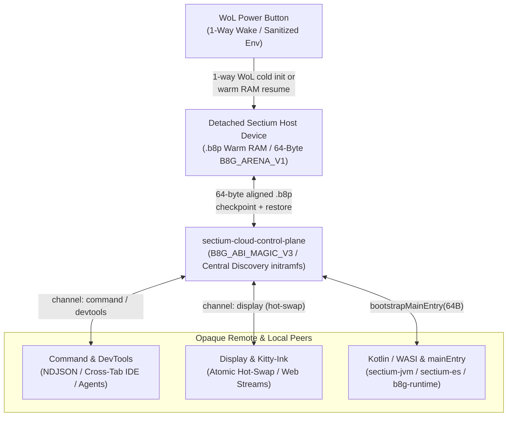

# Sectium Cloud Control Plane (`B8G_ABI_MAGIC_V3`)

> **Status:** Canonical Implementation (`B8G_ABI_MAGIC_V3 = 0x33564742`, ABI v3)  
> **Architecture Spec:** [`docs/architecture/SECTIUM-CLOUD-CONTROL-PLANE.md`](../../docs/architecture/SECTIUM-CLOUD-CONTROL-PLANE.md)  
> **C11 ABI Header:** [`b8g_sectium_cp_abi.h`](./b8g_sectium_cp_abi.h)  
> **TypeScript Binding:** [`index.mts`](./index.mts) · **Test Suite:** [`sectium-cp.test.mts`](./sectium-cp.test.mts)

---

## 1. Overview: Central Discovery `initramfs` & Collapsed Control Plane

`sectium-cloud-control-plane` collapses host wake-on-LAN (`WoL`), `.b8p` warm-RAM checkpointing, 64-byte-aligned `B8G_ARENA_V1` `initramfs` discovery, opaque peer channel multiplexing, and `<b8g-*>` Web Stream fan-out into a single flat control plane.

Whether booting bare-metal T2 SDE UEFI, Windows 11 Sectium Host, WASI, or a remote cloud node, `sectium-cloud-control-plane` acts as the minimal self-discovery **`initramfs`** that mounts or restores the 64-byte-aligned `B8G_ARENA_V1` RAM region (`.b8p` warm checkpoint) and bootstraps `lo`-style single-entrypoint `mainEntry` targets (`sectium-es`, `sectium-jvm` / Kotlin WASI, `b8g-runtime`, or Sectium Display) with merged RAM alignment.



---

## 2. Measured Cross-Compiled C11 Artifacts (`dist/`)

All four native and WASI artifacts compile with `0` warnings via `.\bin\zig.cmd cc -std=c11 -O2 -Wall -s` and remain well under the `100 KB` budget:

| Artifact | Target Triple | Format / Magic | Measured Size |
| :--- | :--- | :--- | :--- |
| `dist/sectium_cp.dll` | `x86_64-windows-gnu` | Win64 PE DLL (`4d 5a`) | `20,480 B` (`20.0 KB`) |
| `dist/libsectium_cp.so` | `x86_64-linux-musl` | Linux ELF64 (`7f 45 4c 46`) | `5,080 B` (`5.0 KB`) |
| `dist/sectium_cp.wasm` | `wasm32-wasi` | WebAssembly (`00 61 73 6d`) | `5,695 B` (`5.6 KB`) |
| `dist/sectium-cp-probe.exe` | `x86_64-windows-gnu` | Win64 PE Probe (`4d 5a`) | `24,576 B` (`24.0 KB`) |

---

## 3. Pure-C11 Zero-Header ABI (`b8g_sectium_cp_abi.h`)

- **Magic:** `B8G_ABI_MAGIC_V3 = 0x33564742u` (`"BGV3"`)
- **Version:** `B8G_CP_ABI_VERSION = 3u`
- **Power Modes:** `COLD_INIT = 0`, `WARM_RAM_RESUME = 1`, `DETACHED_DAEMON = 2`
- **Channel Kinds:** `COMMAND = 1`, `DISPLAY = 2`, `DEVTOOLS = 3`
- **Error Codes:** `OK = 0`, `ERR_INVALID_ARG = -1`, `ERR_DEVICE_OFFLINE = -2`, `ERR_NO_SNAPSHOT = -3`, `ERR_SLOTS_FULL = -4`

| Exported Symbol | Signature | Behavior |
| :--- | :--- | :--- |
| `sectium_cp_abi_magic` | `uint32_t (void)` | Returns `0x33564742u` (`B8G_ABI_MAGIC_V3`). |
| `sectium_cp_create` | `SectiumCpHandle* (const char* endpoint)` | Allocates an offline control-plane handle. |
| `sectium_cp_wol_wake` | `int32_t (h, power_mode, resume_epoch)` | Performs 1-way WoL cold init or `.b8p` warm-RAM resume. |
| `sectium_cp_checkpoint_ram` | `int32_t (h, uint64_t* out_epoch)` | Increments and persists the `.b8p` warm-RAM snapshot epoch. |
| `sectium_cp_attach_channel` | `int32_t (h, kind, peer_id, out_slot, out_replaced)` | Attaches an opaque peer; atomic hot-swap on `DISPLAY`; returns `ERR_DEVICE_OFFLINE` if offline. |
| `sectium_cp_detach_channel` | `int32_t (h, uint32_t slot_id)` | Detaches a peer slot without interrupting other channels. |
| `sectium_cp_power_off` | `int32_t (h)` | Stops live transport while preserving `snapshot_epoch` for warm resume. |
| `sectium_cp_status` | `int32_t (h, SectiumCpStatus* out_status)` | Writes the flat POD `SectiumCpStatus` struct. |
| `sectium_cp_destroy` | `void (SectiumCpHandle* h)` | Releases the control-plane handle. |

---

## 4. TypeScript API (`SectiumCloudControlPlane`)

`index.mts` unifies `SectiumDeviceHost`, `SectiumDeviceClient`, `SectiumDevToolsPlane`, and `createKittyInkWritableStream`:

- `wakeDetached(opts?)`: 1-way WoL wake (cold init on first wake; `.b8p` warm-RAM resume when `snapshotEpoch > 0`).
- `bootstrapMainEntry({ id, kind, arenaAlignBytes: 64 })`: mounts a 64-byte-aligned `B8G_ARENA_V1` slice for single-entrypoint targets (`sectium-es`, `sectium-jvm`, `b8g-runtime`, `sectium-display`).
- `checkpointRamEpoch()`: increments and records the `.b8p` warm-RAM epoch.
- `powerOff()`: stops live transport while preserving `snapshotEpoch`.
- `attachOpaquePeer(channel, peerId)`: treats local and remote clients identically; atomic hot-swap on `'display'`.
- `createB8gStreamFanOut(opts)`: native WHATWG Web Streams `.tee()` fan-out into `createKittyInkWritableStream`.
- `getRollingReleaseManifest()`, `stageRollingRelease(next)`, `rollbackRollingRelease()`: rolling-release plane metadata (`rolling | canary | stable`) with `B8G_ABI_MAGIC_V3` / `abiVersion >= 3` validation, epoch bump, and `O(1)` rollback.
- `getStatus()` and `verifyNativeAbiProbe()`: returns flat status or runs `dist/sectium-cp-probe.exe` (`shell: false`).

---

## 5. Verification

```powershell
.\sections\sectium-cloud-control-plane\dist\sectium-cp-probe.exe
.\bin\node.ps1 --test sections/sectium-cloud-control-plane/sectium-cp.test.mts
.\bin\b8g-web-doc.ps1 sections/sectium-cloud-control-plane/README.md
```
